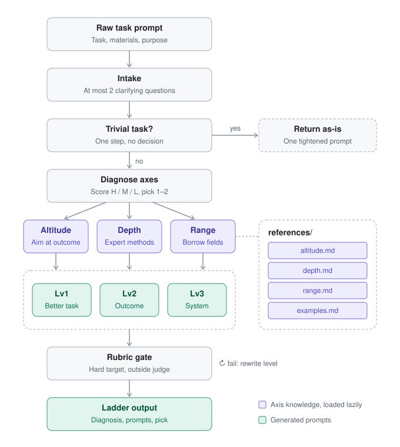

# ambitious-prompt

A Claude Code skill that takes an ordinary task prompt and returns a three-level ladder of prompts you can run as written. Each level aims higher, works deeper, or draws on more fields, and none of them lets the model grade its own work.

```text
/ambitious-prompt Make our dashboard page load faster. I have repo access and a staging URL.
```

You give it one task. It gives back:

- a diagnosis of which kind of ambition fits the task,
- three prompts (Lv1 better task, Lv2 outcome, Lv3 system),
- for each prompt, the prerequisites, the outside judge that decides success, and the cost,
- a recommendation for which level to start with.

---

## Reference

This skill turns the framework in **Felix Rieseberg's essay [“How to be more ambitious: A tutorial for humans with models”](https://felixrieseberg.com/how-to-be-more-ambitious-a-tutorial-for-humans-with-models/)** (October 2026) into a repeatable procedure.

The essay names four kinds of ambition to apply when working with models:

| Type | Idea in the essay | In this skill |
|---|---|---|
| Speed | The same work in less time | Out of scope; no prompt rewrite is needed for it |
| Altitude | Work on the outcome instead of the individual task | `references/altitude.md` |
| Depth | Work the way a field-leading expert would: rawer inputs, real instruments, outside validation | `references/depth.md` |
| Range | Pull in knowledge, tools, and methods from fields the task doesn't obviously need | `references/range.md` |

The essay is written for people, and it leaves applying these ideas to judgment. The skill turns that judgment into explicit steps a model can follow: fit signals per axis, a fixed output contract, and a rubric every generated prompt must pass. The essay's quarterly-business-review example is the basis of [`examples.md`](skills/ambitious-prompt/references/examples.md), and its four-question "deeper version" prompt is the basis of the [deepen-only shortcut](skills/ambitious-prompt/references/depth.md#four-question-pass).

The ideas and the framework belong to the essay's author. This repository contains only the implementation as a skill. It is an independent project, not affiliated with or endorsed by the author or Anthropic.

---

## How it works

<p align="center">
  
</p>

| Stage | What happens | Why |
|---|---|---|
| **Intake** | The skill pulls four things from the conversation: the original prompt, its purpose (who uses the result and what they decide), the materials (data, repos, connectors, logs), and the environment (code execution, subagents, web). It asks at most two clarifying questions. | Ambitious prompts depend on access. A prompt that assumes data the runner can't reach fails partway through. |
| **Trivial-task gate** | One-step tasks with no downstream decision and no data get a single tightened prompt, and the skill stops. | It should not turn "fix this typo" into a systems project. |
| **Diagnose** | Each axis is scored High / Medium / Low using fixed signals (below). The skill picks the strongest 1–2 axes. | Applying all three axes to every task makes the prompt longer without making it better. |
| **Build ladder** | Only the reference files for the chosen axes are loaded. The skill writes Lv1 → Lv2 → Lv3. | Loading references on demand keeps `SKILL.md` small and the context focused. |
| **Rubric gate** | Each prompt is checked against eight rules. Any prompt that fails is rewritten before the user sees it. | This is where the essay's advice is actually enforced. |
| **Output** | Diagnosis table, three prompts each with prerequisites, outside judge, and cost, then a recommendation. | The fixed format makes results comparable across runs and easy to paste. |

### Axis fit signals

| Axis | High when | Low when |
|---|---|---|
| **Altitude** | A meeting, review, or decision follows the work; the task recurs; there is an obvious next thing the user wants to happen | Creative work valued for its own sake |
| **Depth** | Raw data or primary sources exist; correctness can be checked by a tool, test, holdout set, or real measurement | No data access; quality cannot be checked |
| **Range** | The output has to persuade, teach, or change behavior; describing the work with verbs instead of nouns reveals several distinct skills | Narrow technical fixes |

### The ladder

| Level | Scope | Typical shape |
|---|---|---|
| **Lv1: Better task** | Same scope as the original | Full context, raw inputs, a hard target, an outside check |
| **Lv2: Outcome** | The decision or result the task serves | "Which decisions are most urgent, with options and arguments for and against each, backed by our data" |
| **Lv3: System** | Replace the recurring process | A redesigned mechanism, backtested on the user's own history, run beside the current process. Includes the plumbing needed to take the human out of the loop. |

### The rubric

Every generated prompt must pass all eight checks:

1. **Hard, specific target.** A number, threshold, or deadline, set past comfortable (10s → 200ms, not 10s → 5s), and stated as solvable. "Do your best" fails. The essay draws on goal-setting research showing that specific hard goals beat "try your best."
2. **Raw material named.** Logs, tables, transcripts, crash dumps, not a summary of them.
3. **Instruments named.** The actual methods and tools, such as SQL with a survival model, or a profiler with a flame graph. Prompts that switch to expert vocabulary without switching methods fail this check.
4. **An assumption challenged.** At least one belief the user holds is tested against raw data.
5. **Outside judge.** Tests, a holdout set, a benchmark, a reproduction, or a real measurement decides success. The model never reviews its own work.
6. **No role play.** "Act as a short seller" becomes "do what a short seller does: find the three metrics management would least want scrutinized and trace each to raw data."
7. **Stop condition.** When to stop, and what to keep pushing on if the target looks impossible.
8. **Prerequisites listed separately.** Missing access is never hidden inside the prompt.

---

## Installation

The skill is a plain folder. Copy it to wherever Claude Code looks for skills.

**Personal (all projects):**

```bash
git clone https://github.com/Yooh-an/ambitious-prompt.git /tmp/ambitious-prompt
```

```bash
cp -R /tmp/ambitious-prompt/skills/ambitious-prompt ~/.claude/skills/
```

**Single project (shared with your team through git):**

```bash
cp -R /tmp/ambitious-prompt/skills/ambitious-prompt .claude/skills/
```

Claude Code picks up new skills without a restart. To confirm the install, check that `ambitious-prompt` appears in the skill list, or run `/ambitious-prompt` directly.

> **Permissions.** `SKILL.md` declares `allowed-tools: Read` so the skill can open its own reference files without asking each time. Because of that, Claude Code asks you once, on first use, to approve running the skill. After that approval it runs without prompts. In non-interactive runs (`claude -p`), pass `--allowedTools "Skill(ambitious-prompt)"`.

---

## Usage

**Explicit:**

```text
/ambitious-prompt Write 5 posts for our X account this week. I have 90 days of X analytics as CSV.
```

**Natural language.** The skill triggers on requests such as:

- "make this prompt more ambitious: …"
- "give me a deeper version of this task: …"
- "프롬프트 업그레이드해줘: …" / "더 야심차게 바꿔줘: …"

**Getting better results.** Add one line each about:

- **Materials:** what the runner can actually reach ("Shopify order CSV + GA4 access", "repo + staging URL").
- **Purpose:** who uses the result and what they decide ("leadership sets next quarter's ad budget from this").

**Variants:**

| Ask | Result |
|---|---|
| "just one deeper version" | Deepen-only shortcut: the four-question pass, one rewritten prompt, prerequisites, outside judge |
| "Range only" / "Altitude only" | The ladder restricted to that axis |
| A trivial task | One tightened prompt and a note that a ladder isn't worth it |

The skill replies in your language. Generated prompts use the language you will run them in. Tool names and code stay in English.

---

## Examples

Both examples are excerpts from real headless runs of this skill (Claude Code 2.1.300, `claude -p`), lightly trimmed for length.

### 1. Engineering: “Make our dashboard page load faster.”

**Diagnosis**

| Axis | Fit | Why |
|---|---|---|
| Depth | High | Speed is machine-checkable (Lighthouse/WebPageTest, traces, query plans, RUM), and the raw material (repo + staging) is already available |
| Altitude | High | A one-off fix decays. What the user wants is a dashboard that stays fast |
| Range | Low | A narrow technical outcome, so other fields add little |

**Lv1: Measured, root-caused speedup** (excerpt)

```text
Make the dashboard page at <staging-url>/<dashboard-path> load fast, measured, not guessed.

Targets (p75, Moto G Power / Slow 4G AND desktop/cable, realistic data volume):
- LCP ≤ 1.2s, INP ≤ 100ms, CLS ≤ 0.05, time-to-all-widgets-interactive ≤ 1.5s
- Initial JS ≤ 150KB gzipped; slowest dashboard API call p95 ≤ 150ms
These are achievable. If one looks impossible, say what blocks it, what you tried,
and keep going on the most promising path.

Method:
1. Baseline: Lighthouse CI + WebPageTest (5 runs each, median), a Chrome performance
   trace and a HAR. Record in perf/BASELINE.md.
2. Build the critical-path waterfall: HTML → JS → auth → each API call → render.
3. Frontend: bundle analyzer + React Profiler.
4. Backend: server timing, EXPLAIN ANALYZE, N+1 detection. Cut DB time before adding caches.
5. Test this assumption against the trace: "the dashboard is slow because of the frontend."

Done = targets met on 5-run medians, existing tests pass, no visual diff
(Playwright screenshot comparison).
```

- **Prerequisites:** a staging test account with realistic data, read access to the staging DB or APM, Playwright installed locally
- **Outside judge:** Lighthouse/WebPageTest medians, the test suite, Playwright visual diff
- **Cost:** a few hours in one session

**Lv2: Make "fast" the default** pulls real-user p75/p95 by device and account size, ranks bottlenecks by *user-minutes lost* instead of by how easy they are to fix, adds a CI performance budget, and proves the budget works by submitting a PR that deliberately regresses performance and confirming CI fails it.

**Lv3: Own latency as an SLO** builds a see → map → act → verify → report loop that bisects regressions to commits and opens fix PRs. Before it goes live, it is backtested on 90 days of deploys, then run in report-only mode for two weeks.

**Recommendation:** start at Lv1. Lv2 and Lv3 depend on the baseline and the measurement harness that Lv1 produces.

### 2. Analytics (Korean input): “우리 쇼핑몰 지난달 매출 리포트 엑셀로 정리해줘”

Input: *"Turn our store's sales report for last month into an Excel file. Materials: Shopify order CSV, GA4 access."*

| Axis | Fit | Why (translated) |
|---|---|---|
| Altitude | High | A monthly report that feeds budget, inventory, and promotion decisions, with Black Friday six weeks away |
| Depth | High | Order-level CSV and raw GA4 events exist, and totals can be reconciled against the Shopify admin |
| Range | Low | A numbers report, so methods from other fields add little |

- **Lv1** reconciles net sales to the Shopify admin total within ±0.5% before it formats anything. It also measures the GA4↔Shopify `transaction_id` match rate, which tests the belief that "GA4 channel revenue represents real revenue."
- **Lv2** decomposes the month-over-month change into sessions × conversion × AOV with less than 5% unexplained residual, adds contribution margin by channel and cohort LTV, and backtests the model on the previous month (MAPE ≤ 10%) before any forecast is used.
- **Lv3** turns the report into a pipeline: Shopify Admin API → DuckDB → .xlsx on the 1st of each month, with anomaly alerts. It rebuilds the last 12 months to prove every month reconciles, and it must catch known past incidents with no more than 2 false alarms a month.

More worked examples, including the essay's QBR ladder, are in [`references/examples.md`](skills/ambitious-prompt/references/examples.md).

---

## Repository structure

```text
ambitious-prompt/
├── README.md
├── LICENSE
├── docs/
│   └── pipeline.svg              # the diagram above (light/dark aware)
└── skills/
    └── ambitious-prompt/         # ← copy this folder into .claude/skills/
        ├── SKILL.md              # workflow, axis signals, ladder, rubric, output contract
        └── references/
            ├── altitude.md       # goal-beyond-the-goal ladder, human-out-of-the-loop plumbing
            ├── depth.md          # five techniques, raw-material ladder, four-question pass
            ├── range.md          # nouns → verbs, crew assembly, methods-not-roles, orchestration template
            └── examples.md       # QBR full ladder + engineering and content examples
```

| File | Loaded when | Size budget |
|---|---|---|
| `SKILL.md` | Every invocation | Kept under ~150 lines so it is cheap to load |
| `references/<axis>.md` | Only when that axis is selected | One topic per file |
| `references/examples.md` | When the model wants a few-shot anchor | Free-form |

---

## Design decisions

- **A ladder, not one "best" prompt.** Users differ in how far they are ready to go, and the right level depends on access they may not have yet. Three runnable levels let the user pick, and the recommendation explains the pick.
- **The outside judge is mandatory.** The essay is explicit that the model should not judge itself. Every level names a test, holdout, benchmark, or measurement. If no outside judge exists, building one becomes part of the prompt.
- **Methods instead of personas.** The essay warns that asking a model to act like a professional often changes only the vocabulary. The rubric rejects "act as X" and requires the concrete method X would use.
- **Prerequisites are separate from the prompt.** An ambitious prompt hits missing access sooner than a timid one. Listing access separately turns "this failed halfway" into "connect GA4 first."
- **Speed is excluded.** Doing the same work faster doesn't need a different prompt, so the skill spends its budget on the three axes that do.
- **A gate against inflating small tasks.** A skill that makes every request bigger becomes noise, so trivial tasks exit early.
- **Range compiles to orchestration.** When subagents are available, Range is written as parallel workstreams (one per field plus a red team) with an explicit merge step. That makes the essay's "assemble the crew" idea something that actually runs.

---

## Validation

| Check | Command | Result |
|---|---|---|
| Structure / frontmatter | `python scripts/quick_validate.py skills/ambitious-prompt` (from Anthropic's `skill-creator`) | `Skill is valid!` |
| Trigger: Korean natural language | `claude -p "이 프롬프트 더 야심차게 업그레이드해줘: '…매출 리포트 엑셀로 정리해줘'…"` | Skill invoked; Altitude + Depth chosen; full ladder produced |
| Trigger: English, references loaded | `claude -p "make this prompt more ambitious: 'Make our dashboard page load faster.' …" --allowedTools "Skill(ambitious-prompt)"` | Skill invoked; `depth.md` and `altitude.md` read; full ladder produced |

To reproduce a run and see which tools it called:

```bash
claude -p "make this prompt more ambitious: 'Make our dashboard page load faster.'" --allowedTools "Skill(ambitious-prompt)" --output-format stream-json --verbose > run.jsonl
```

---

## Limitations

- **Outputs are prompts, not results.** The skill doesn't run the Lv1–Lv3 prompts. Paste one into a session that has the listed prerequisites.
- **Very open outcomes still fail.** "Go make money" style goals are too broad for current models, as the essay notes. Lv3 prompts are always bounded by a metric, a scope, and a time window.
- **Diagnosis is heuristic.** The fit signals are rules of thumb. If you disagree with the diagnosis, say "Range only" or "Altitude only" to override it.
- **Cost grows with level.** Lv3 prompts often mean multi-session, multi-agent work. Each level states its expected cost so you can decide up front.
- **One approval on first use** because of `allowed-tools: Read` (see Installation).

---

## Contributing

Issues and pull requests are welcome, especially:

- before/after examples from other domains (research, design, ops, finance) for `references/examples.md`,
- cases where the diagnosis chose the wrong axis, with the input that caused it,
- rubric checks that would have caught a weak prompt.

When changing `SKILL.md`, keep it short and move detail into `references/`.

---

## License

[MIT](LICENSE). The framework this skill implements comes from [Felix Rieseberg's essay](https://felixrieseberg.com/how-to-be-more-ambitious-a-tutorial-for-humans-with-models/). Read it for the reasoning behind each idea.
